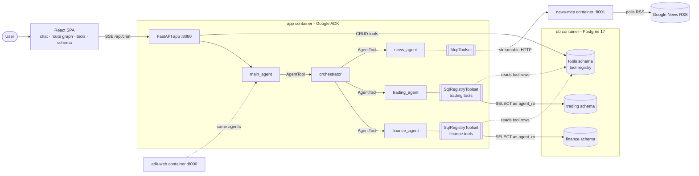

# Nimbus Markets: a Google ADK multi-agent teaching demo

A self-contained demo for Google DevFest that shows how to build a **multi-agent system with
[Google ADK](https://google.github.io/adk-docs/)**:

- a **main agent** delegates to an **orchestrator**, which routes each question to **finance**,
  **trading** and **news** specialists, in parallel or one after another;
- the finance and trading agents get their tools from a **tool registry in Postgres**. A tool is a row
  holding a parameterised SQL query or a curated "factual" answer, turned into a typed ADK
  `FunctionTool` at runtime and **hot-reloaded**: register a tool in the UI and the agents use it on the
  next question, with no restart;
- the news agent talks to our own **MCP server**, which polls free RSS feeds;
- a React UI shows the **live route** each question takes through the agents, lets you **write and test
  new tools**, and documents the **database schema** you write them against.

Everything starts with one command on Docker or Podman.

> **All data is synthetic.** "Nimbus Markets" is a fictional broker. Every client, price, trade, ledger
> line and budget is generated by `scripts/generate_synthetic_data.py`: random walks and random name
> combinations, no real market data, no real people. Only the news headlines are real (public RSS).

## Quickstart (3 steps)

You need Docker (with Compose v2) **or** Podman with `podman-compose`, plus `make`.

1. `cp .env.example .env`
2. Put **one** LLM key in `.env`:
   - **Option A (direct Gemini):** paste a free key from [Google AI Studio](https://aistudio.google.com/apikey)
     into `GEMINI_API_KEY=`.
   - **Option B (LiteLLM proxy):** set `LITELLM_GEMINI_API_KEY=` and
     `OPENAI_BASE_URL=https://your-litellm-proxy.example.com/v1`, and optionally
     `AGENT_MODEL=openai/gemini-3.8-flash`.
3. `make up` (Docker) or `make podman-up` (Podman).

The first start builds the images and loads the synthetic data, which takes a few minutes. After that:

| What | URL |
|---|---|
| Chat UI + tool registry + schema browser | http://localhost:8080 |
| ADK's built-in dev UI (`adk web`) | http://localhost:8000 |
| Postgres (psql / DBeaver) | `localhost:5432`, db `nimbus`, user `postgres` / `postgres` |
| News MCP server | http://localhost:8001/mcp (health: `/healthz`) |

> **Local use only.** The API and UIs have no authentication and Postgres uses default credentials, so every port is published on `127.0.0.1` only (`BIND_ADDRESS` in `.env`). Don't change it to `0.0.0.0` on a shared network.

If you forget step 2, `make up` creates `.env` for you and stops with
*"add your LITELLM_GEMINI_API_KEY (or GEMINI_API_KEY) to .env, then re-run"*. `.env` is git- and
docker-ignored, so the key is never committed or baked into an image.

Other useful targets: `make down`, `make logs`, `make ps`, and `make reset`, which wipes the database
volume and reloads the CSVs. Each has a `podman-*` twin. There is also `make test`, plus `make help`.

## Architecture



| Service | Role | Port |
|---|---|---|
| `db` | Postgres 17. On first start it runs `db/init/*.sql` (schemas, roles, comments) and `COPY`s `db/seed/*.csv` | 5432 |
| `news-mcp` | MCP server (`latest_headlines`, `search_news`, `list_feeds`) with a background RSS listener | 8001 |
| `app` | FastAPI + ADK agents + the built SPA. Seeds `seed/starter_tools.yaml` into the registry at startup | 8080 |
| `adk-web` | Same image, running `adk web` so you can inspect the same agents in ADK's dev UI | 8000 |

More detail in the docs:

- [docs/ARCHITECTURE.md](docs/ARCHITECTURE.md): containers, data model, the tool registry, safety.
- [docs/ORCHESTRATION.md](docs/ORCHESTRATION.md): how the orchestrator classifies and fans out.
- [docs/WORKSHOP.md](docs/WORKSHOP.md): hands-on, build your own tools.
- [docs/DEMO_SCRIPT.md](docs/DEMO_SCRIPT.md): talk track and the questions that show each storyline.
- [docs/CONTRACT.md](docs/CONTRACT.md): the build contract (API, env vars, DB schema).

## Repository layout

```
compose.yaml  Makefile  .env.example       one-command startup (Docker or Podman)
docker/       app.Dockerfile (node build -> python 3.13), news-mcp.Dockerfile
db/init/      DDL + COMMENT ON (the schema docs the UI shows) + COPY of the seed CSVs
db/seed/      committed synthetic CSVs (regenerate with `make data`)
seed/         starter_tools.yaml - 3 finance + 3 trading SQL tools
scripts/      generate_synthetic_data.py (deterministic, stdlib only)
news_mcp/     MCP news server (server.py, feeds.py)
src/devfest_agents/   agents, tool registry/factory/toolset, tracing, FastAPI
web/          React SPA
tests/        pytest suite (incl. seed-data consistency and a banned-terms guard)
docs/
```

## Development

```bash
make dev        # db + news-mcp in containers; prints the commands to run the API and the SPA locally
make test       # pytest + web typecheck
make data       # regenerate the synthetic CSVs, then `make reset` to load them
make seed-tools # force re-upsert the starter tools (ENGINE=podman for podman)
make update-pkg PKG=litellm VERSION=1.108.1   # pin a Python package (uv add PKG==VERSION)
```

### Security scanning (trivy)

Needs [trivy](https://trivy.dev) (`brew install trivy`).

```bash
make trivy-scan    # fail on fixable HIGH/CRITICAL vulns in uv.lock + web/package-lock.json
make trivy-patch   # upgrade every fixable package; rolls back any fix that would downgrade another package
make trivy-verify  # pytest + SPA typecheck/tests/build (catches breaking upgrades)
make trivy-audit   # patch -> verify -> scan, in one go
make trivy-image   # scan the built images too (ENGINE=podman for podman)
make trivy-config  # Dockerfile / compose misconfiguration report
```

The database init scripts only run when the Postgres volume is empty. After changing `db/init` or
`db/seed`, run `make reset` (or `make podman-reset`).
