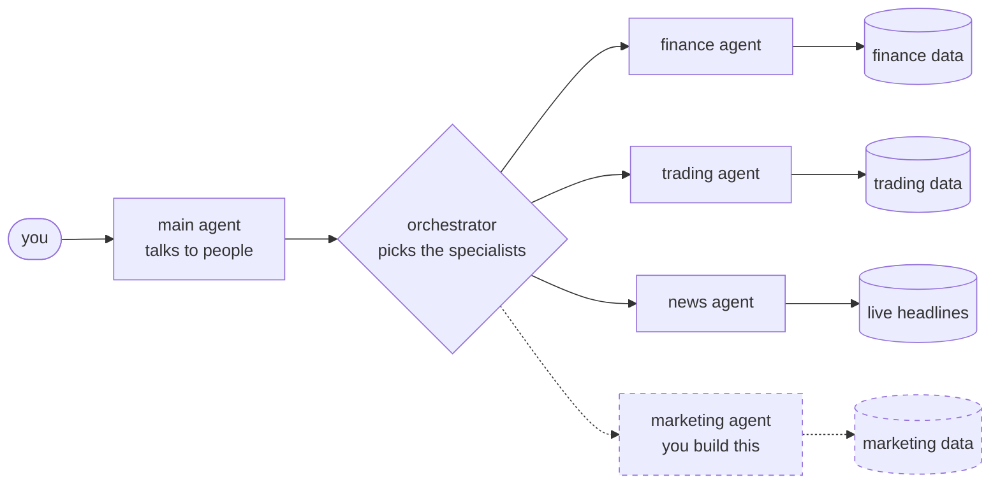
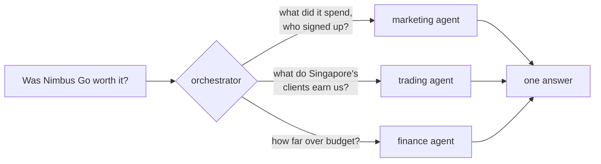

# The marketing agent workshop

Nimbus Markets is a fictional online broker with an AI assistant built with
[Google ADK](https://google.github.io/adk-docs/). It answers questions about **finance**,
**trading** and the day's **market news**, but not about **marketing**.

Your task is to add a marketing agent, connect it to the assistant, and measure how well it
answers. You submit your `my_agent/` folder, and it's scored on questions you haven't seen.
[The task](#the-task) has the details.

## How the session runs

| Step | What you do |
|---|---|
| Set up | [Set up](#set-up), and read [the task](#the-task) while it builds |
| [Exercise 0: Exploring the app](exercises/0-explore.md) | See what the assistant can't answer yet |
| [Exercise 1: Creating tools](exercises/1-tools.md) | Wrap two marketing queries as tools |
| [Exercise 2: Creating an agent](exercises/2-agent.md) | Give the tools to a marketing agent |
| [Exercise 3: Adding an agent to the orchestrator](exercises/3-orchestrator.md) | Let the orchestrator send marketing questions to it |
| [Exercise 4: Routing across agents](exercises/4-routing.md) | Ask several agents, in parallel or in order |
| [Exercise 5: Evaluating agents](exercises/5-evals.md) | Score it, fix one failure, score again |
| [Submit](exercises/5-evals.md#the-competition) | Upload your `my_agent/` folder |
| Wrap up | The leaderboard, and the answer to the final question |

Each exercise ends with a check, like `make check-1`, and a link to the next one. If you fall
behind, open the hints: every exercise has one that shows the finished code.

## Before the session

Have these ready on your laptop:

- **Docker**, installed and running. [Install Docker](#install-docker) shows how.
- **`git`** and **`make`**.
- **An LLM API key** from any provider, for a model that supports tool calling. Gemini, OpenAI
  and Anthropic keys all work, as does any provider [LiteLLM](https://docs.litellm.ai/docs/providers)
  supports. At the session, every participant can claim free Google credits: the slides show
  the QR code. Use them for a Gemini key, with `AGENT_MODEL=gemini/gemini-3.7-flash`.
- **Some Python.** You'll write two short `async def` functions with type hints and docstrings,
  and fill in one function call. You don't need Python installed: everything runs in Docker.

### Install Docker

**macOS.** Install [Docker Desktop for Mac](https://docs.docker.com/desktop/setup/install/mac-install/)
and open it. For `git` and `make`, run:

```bash
xcode-select --install
```

**Windows.** You'll work inside WSL, the Linux that comes with Windows.

1. Open PowerShell as administrator, run `wsl --install`, and restart. Then open **Ubuntu** from
   the Start menu and choose a username and password.
2. Install [Docker Desktop for Windows](https://docs.docker.com/desktop/setup/install/windows-install/).
   In its settings, under **Resources > WSL integration**, turn on Ubuntu.
3. In the Ubuntu window, install `git`, `make` and `zip`:

   ```bash
   sudo apt update && sudo apt install -y git make zip
   ```

Run every command in this workshop in the Ubuntu window. Clone the repo into your Linux home
folder (`cd ~` first), not under `/mnt/c`: from there, the app doesn't see the files you save.

**Linux.** Install [Docker Engine](https://docs.docker.com/engine/install/) with the Compose
plugin, then let your user run Docker without `sudo`, and log out and back in:

```bash
sudo usermod -aG docker $USER
```

Install `git` and `make` with your package manager.

**Check it works.** Both of these should succeed:

```bash
docker run --rm hello-world
```

```bash
docker compose version
```

## Set up

**1. Get the code.**

```bash
git clone <this repo's URL>
cd googledevfest2026-adk-multiagent
```

**2. Add your key.** Copy the settings file:

```bash
cp .env.example .env
```

Then open `.env` and fill in two lines:

```bash
LLM_API_KEY=<your key>
AGENT_MODEL=<provider>/<model>
```

`AGENT_MODEL` is the provider, a slash and the model, for example `gemini/gemini-3.7-flash` or
`anthropic/claude-sonnet-5-5`. [LiteLLM's provider list](https://docs.litellm.ai/docs/providers)
has the names for the others. If your key is for an OpenAI-compatible endpoint, such as a LiteLLM
proxy or OpenRouter, also set `LLM_BASE_URL=<its URL>` and use `openai/<model>`.

The practice questions were tested on `gemini/gemini-3.7-flash`. Other models score differently,
and slow ones make `make eval` slower. The competition runs everyone's agent on the same model,
so the key you use here doesn't change your competition score.

**3. Start the app.**

```bash
make up
```

The first start takes a few minutes: it downloads about 1 GB, builds the app and loads the data.
Read [the task](#the-task) while it runs.

**4. Open http://localhost:8080.** You should see the Overview page. Then start
[exercise 0](exercises/0-explore.md).

## The task

**Background.** Nimbus Markets has four companies: NM-UK, NM-SG (Singapore), NM-AE (Dubai) and
NM-INTL. In June 2026, NM-SG launched a mobile app, **Nimbus Go**, with paid ad campaigns. The
database holds the marketing data: campaigns, daily ad spend and sign-ups. No agent reads it yet.

**What you're given:**

- a working assistant with a main agent, an orchestrator and three specialists: finance, trading
  and news;
- `my_agent/marketing_queries.py`, tested queries over the marketing data, as Python functions;
- a starter `my_agent/` folder, a check for each exercise, and practice questions.

**What you build:**

1. tools that wrap the marketing queries;
2. a marketing agent that uses them;
3. the routing that sends marketing questions to it, alone or together with the other agents.

**How it's scored.** Every question earns one point for asking the right agents and one for a
correct answer. `make eval` runs the practice questions; the hidden ones are in the same style.
The final question is *"Was the Nimbus Go launch campaign worth the money?"* A good answer gives
the figures and says what the data can't show.

**What you hand in.** Your `my_agent/` folder, zipped by `make submit`.

## How the assistant works

The assistant has a main agent, an orchestrator and three specialists: finance, trading and
news. You add the fourth.



The main agent talks to people. The orchestrator reads each question, decides which specialists
it needs, asks them, and merges what they say. Each specialist knows one part of the business and
reads only its own data. The news agent reads live headlines. No exercise uses it, but the
orchestrator still sends it news questions.

The final question needs three of them at once:



## Where your work goes

Everything you write goes in one folder, `my_agent/`:

```
my_agent/
  marketing_agent.py      your two tools and your agent       exercises 1 and 2
  marketing_queries.py    the marketing queries; your tools call these
  team.py                 the agents the orchestrator can call    exercise 3
  prompts/
    marketing_agent.md    how your agent behaves                exercise 5
    orchestrator.md       how questions get routed              exercises 3 and 4
    main_agent.md         the assistant's persona               exercise 5
```

The rest of the app is in `platform/`. You never need to open it.

**How your changes show up.** You never restart anything. Save a file, and the app restarts
itself in about 2 seconds. Ask a question on the **Chat** page, and the **Agent route** panel
shows which agents and tools answered.

## Commands

| Command | What it does |
|---|---|
| `make up` | Start the app |
| `make check-1` | Check exercise 1 (or 0, 2, 3, 4) |
| `make eval` | Score your agents on the practice questions, in about 2 minutes |
| `make eval Q=<id>` | Score one question again |
| `make eval P=2` | Score more slowly, for a shared key or one that hits rate limits |
| `make submit NAME="<you>"` | Zip your `my_agent/` folder for the competition |
| `make logs` | Show the app's logs. Use it when something breaks |
| `make reset` | Reload the database from scratch |
| `make down` | Stop the app |

The app is at http://localhost:8080. ADK's own developer UI, with the same agents, is at
http://localhost:8000.

## If something goes wrong

| Problem | Fix |
|---|---|
| `make up` says Docker isn't running | Start Docker Desktop and wait until it says it's running. On Linux: `sudo systemctl start docker`. Then `make up` again. |
| `permission denied` on Linux | Run `sudo usermod -aG docker $USER`, log out and back in, then `make up` again. |
| `make up` stops and asks for a key | Add your key to `.env`, then `make up` again. |
| "port 5432 is already in use" | Another database is running. In `.env`, set `POSTGRES_PORT=5433`, then `make up` again. |
| The first `make up` is very slow | It downloads about 1 GB. Keep going with the task and exercise 0's reading. |
| Every chat answer is an error about the model or the key | Check `AGENT_MODEL` and `LLM_API_KEY` in `.env`, then `make up` again. If it mentions `reasoning_effort`, add `LLM_REASONING_EFFORT=` to `.env`. |
| The chat stops answering after you save a file | You have a Python error. Run `make logs`, fix it, save again. |
| On Windows, saving a file changes nothing | The repo is under `/mnt/c`. Clone it again from `cd ~` in the Ubuntu window. |
| `make eval` shows "rate limit" or many timeouts | Run `make eval P=2`. |
| The data looks wrong | Run `make reset`. |

## Security: for your own machine only

This repo is a workshop template. It is built to run on one laptop, for one person, with made-up
data, so it has no logins.

- **Every port listens on `127.0.0.1` only** (`BIND_ADDRESS` in `.env`). Nobody else on your
  network can reach the app, the ADK dev UI or Postgres. Don't change it to `0.0.0.0`, especially
  on shared or conference Wi-Fi.
- **There is no authentication.** Anyone who can reach port 8080 can chat, read the data and
  create, edit or delete tools. The ADK dev UI on port 8000 has no login either.
- **The database passwords are fixed defaults** (`postgres`, `app`, `agent_ro`). They protect a
  throwaway local container.
- **All data is synthetic.** There are no real clients, trades or ledgers.
- **Tool SQL is read-only.** It runs as `agent_ro`: SELECT on finance, trading and marketing only,
  in a read-only transaction with a 5-second timeout.
- **Tool titles and descriptions go into the agents' prompts.** That is how routing works, so only
  add tools you wrote or trust.

## Going deeper

- [How the orchestrator picks agents](platform/docs/ORCHESTRATION.md)
- [How the app is built](platform/docs/ARCHITECTURE.md): containers, data model, tools and safety
- [Maintaining the app](platform/README.md): tests, data, judging, and the reference docs
