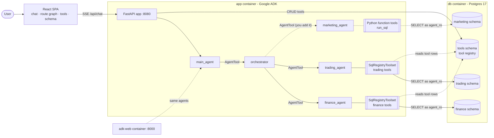

# Nimbus Markets: a Google ADK multi-agent workshop

A self-contained workshop repo for Google DevFest. You fork it, build a **marketing agent** with
[Google ADK](https://google.github.io/adk-docs/), plug it into an existing multi-agent system, and
score it on an eval set.

**Start with [GUIDE.md](GUIDE.md).** It walks you through the workshop step by step.

What is already here:

- a **main agent** delegates to an **orchestrator**, which routes each question to the **finance**
  and **trading** specialists, in parallel or one after another;
- the finance and trading agents get their tools from a **tool registry in Postgres**. A tool is a row
  holding a parameterised SQL query or a curated "factual" answer, turned into a typed ADK
  `FunctionTool` at runtime and **hot-reloaded**: register a tool in the UI and the agents use it on the
  next question, with no restart;
- a `marketing` schema with campaigns, ad spend and sign-ups, which no agent reads yet;
- a React UI that shows the **live route** each question takes through the agents, lets you **write and
  test new tools**, and documents the **database schema**;
- `make eval`, which runs a practice question set through your agents and scores routing and answers.

What you add: a `marketing_agent` whose tools are plain async Python functions over the `marketing`
schema. Once it is in the specialist list, the orchestrator routes campaign questions to it, and
questions that mix marketing with finance or trading start to work.

Everything starts with one command on Docker or Podman.

> **All data is synthetic.** "Nimbus Markets" is a fictional broker. Every client, price, trade, ledger
> line, budget and campaign is generated by `scripts/generate_synthetic_data.py`: random walks and
> random name combinations, no real market data, no real people.

## Quickstart (3 steps)

You need Docker (with Compose v2) **or** Podman with `podman-compose`, plus `make`.

1. `cp .env.example .env`
2. Put **one** LLM key in `.env`:
   - **Option A (direct Gemini):** paste a free key from [Google AI Studio](https://aistudio.google.com/apikey)
     into `GEMINI_API_KEY=`.
   - **Option B (LiteLLM proxy):** set `LITELLM_GEMINI_API_KEY=` and
     `OPENAI_BASE_URL=https://your-litellm-proxy.example.com/v1`, and optionally
     `AGENT_MODEL=openai/gemini-3.8-flash`.
3. `make up` (Docker) or `make podman-up` (Podman).

The first start builds the image and loads the synthetic data, which takes a few minutes. After that:

| What | URL |
|---|---|
| Chat UI + tool registry + schema browser | http://localhost:8080 |
| ADK's built-in dev UI (`adk web`) | http://localhost:8000 |
| Postgres (psql / DBeaver) | `localhost:5432`, db `nimbus`, user `postgres` / `postgres` |

> **Local use only.** The API and UIs have no authentication and Postgres uses default credentials, so every port is published on `127.0.0.1` only (`BIND_ADDRESS` in `.env`). Don't change it to `0.0.0.0` on a shared network.

If you forget step 2, `make up` creates `.env` for you and stops with
*"add your LITELLM_GEMINI_API_KEY (or GEMINI_API_KEY) to .env, then re-run"*. `.env` is git- and
docker-ignored, so the key is never committed or baked into an image.

`./src` is mounted into the `app` and `adk-web` containers and both reload on change, so Python edits
show up without rebuilding the image.

Other useful targets: `make down`, `make logs`, `make ps`, and `make reset`, which wipes the database
volume and reloads the CSVs. Each has a `podman-*` twin. There is also `make eval`, `make test` and
`make help`.

## Architecture



The dashed parts are what you build in the workshop.

| Service | Role | Port |
|---|---|---|
| `db` | Postgres 17. On first start it runs `db/init/*.sql` (schemas, roles, comments) and `COPY`s `db/seed/*.csv` | 5432 |
| `app` | FastAPI + ADK agents + the built SPA. Seeds `seed/starter_tools.yaml` into the registry at startup. Runs uvicorn with `--reload` | 8080 |
| `adk-web` | Same image, running `adk web --reload_agents` so you can inspect the same agents in ADK's dev UI | 8000 |

More detail in the docs:

- [GUIDE.md](GUIDE.md): the workshop, step by step. Start here.
- [docs/ARCHITECTURE.md](docs/ARCHITECTURE.md): containers, data model, the tool registry, Python tools, safety.
- [docs/ORCHESTRATION.md](docs/ORCHESTRATION.md): how the orchestrator classifies and fans out.
- [docs/CONTRACT.md](docs/CONTRACT.md): the build contract (API, env vars, DB schema, evals).
- [docs/WORKSHOP.md](docs/WORKSHOP.md): extra exercise, teach finance and trading new skills from the UI.
- [docs/DEMO_SCRIPT.md](docs/DEMO_SCRIPT.md): facilitator talk track and the questions that show each storyline.

## Repository layout

```
GUIDE.md      the workshop guide (start here)
compose.yaml  Makefile  .env.example       one-command startup (Docker or Podman)
docker/       app.Dockerfile (node build -> python 3.13)
db/init/      DDL + COMMENT ON (the schema docs the UI shows) + COPY of the seed CSVs
db/seed/      committed synthetic CSVs (regenerate with `make data`)
seed/         starter_tools.yaml - 3 finance + 3 trading SQL tools
scripts/      generate_synthetic_data.py (deterministic, stdlib only)
evals/        practice.yaml - practice questions for `make eval`
src/devfest_agents/   agents, tool registry/factory/toolset, run_sql, tracing, evals, FastAPI
web/          React SPA
tests/        pytest suite (incl. seed-data consistency and a banned-terms guard)
docs/
```

## Development

```bash
make eval       # score your agents on evals/practice.yaml, writes evals/report.json
make eval Q=campaign-spend-q3   # one question only (podman: add ENGINE=podman)
make dev        # db in a container; prints the commands to run the API and the SPA locally
make test       # pytest + web typecheck
make data       # regenerate the synthetic CSVs, then `make reset` to load them
make seed-tools # force re-upsert the starter tools (ENGINE=podman for podman)
make update-pkg PKG=litellm VERSION=1.108.1   # pin a Python package (uv add PKG==VERSION)
```

### Security scanning (trivy)

Needs [trivy](https://trivy.dev) (`brew install trivy`).

```bash
make trivy-scan    # fail on fixable HIGH/CRITICAL vulns in uv.lock + web/package-lock.json
make trivy-patch   # upgrade every fixable package; rolls back any fix that would downgrade another package
make trivy-verify  # pytest + SPA typecheck/tests/build (catches breaking upgrades)
make trivy-audit   # patch -> verify -> scan, in one go
make trivy-image   # scan the built images too (ENGINE=podman for podman)
make trivy-config  # Dockerfile / compose misconfiguration report
```

The database init scripts only run when the Postgres volume is empty. After changing `db/init` or
`db/seed`, run `make reset` (or `make podman-reset`).
