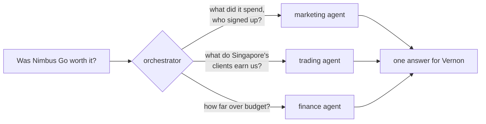

# The marketing agent workshop

Nimbus Markets is an online broker. It has an AI assistant built with
[Google ADK](https://google.github.io/adk-docs/) that answers questions about **finance**,
**trading** and the day's **market news**. It can't answer questions about **marketing**, and Vernon, who runs marketing, needs
answers by Friday.

In this workshop you build the marketing agent and plug it into the assistant. Then you score
your agent on a set of hard questions, and compete for the best score.

## Start here

1. **Set up** the app: [Set up](#set-up), about 5 minutes.
2. **Read the story**: [The story so far](#the-story-so-far), 2 minutes. It explains what you're
   building and why.
3. **Do the exercises in order**, starting with [exercise 0](exercises/0-meet-nimbus.md). Each one
   ends with a check and a link to the next.

## Where your work goes

Everything you write goes in one folder, `my_agent/`:

```
my_agent/
  marketing_agent.py      your tools and your agent           exercises 1 and 2
  marketing_queries.py    the data team's queries; your tools call these
  team.py                 the agents the orchestrator can call    exercise 3
  prompts/
    marketing_agent.md    how your agent behaves              exercise 2
    orchestrator.md       how questions get routed            exercises 3 and 4
    main_agent.md         the assistant's persona             exercise 5
```

The rest of the app is in `platform/`. You never need to open it, although you're free to.

**How your changes show up.** You never restart anything:

1. Save a file. The app notices and restarts itself in about 2 seconds.
2. Ask a question in the app's **Chat** page. The **Agent route** panel shows which agents and
   tools answered, live. Refresh the **Overview** page to see your agent join the diagram.
3. Run `make check-1` (or 0, 2, 3, 4) to check one exercise, or `make eval` to score everything.

Until your agent is plugged in (exercise 3), the app can't show it yet. That's what the checks
are for. If the chat stops answering after a save, you probably have a Python error. Run
`make logs`.

## Set up

You need Docker or Podman, `make`, `git`, and an LLM key. A free Gemini key from
[Google AI Studio](https://aistudio.google.com/apikey) works, or use the key your facilitators
give you.

**1. Get the code.** Fork this repo on GitHub, then clone your fork:

```bash
git clone <your fork's URL>
cd devfest_adk_multiagent
```

**2. Create your settings file.**

```bash
cp .env.example .env
```

**3. Add your key** to `.env`:

- a Gemini key from AI Studio goes after `GEMINI_API_KEY=`;
- if your facilitators gave you a key and a URL instead, add `LLM_API_KEY=<key>` and
  `LLM_BASE_URL=<url>`.

**4. Start the app.**

```bash
make up
```

The first start takes a few minutes. It builds the app and loads the data. `make up` uses Docker
if you have it, and Podman otherwise.

**5. Open http://localhost:8080.** You should see the Overview page.

## The story so far

Nimbus Markets is an online broker. Clients trade currencies, crypto, gold and stock indices
through four companies: Nimbus Markets UK in London, Nimbus Markets SG in Singapore, Nimbus
Markets AE in Dubai, and Nimbus Markets International for everyone else. Inside the company they
go by short codes: NM-UK, NM-SG, NM-AE and NM-INTL.

A few months ago the AI team shipped an assistant, built with Google ADK. You type a question in
plain English and it answers from the company's own data. Finance uses it every morning for P&L
and budgets. The trading desk uses it for volumes and commission, and to catch up on the day's
market news. It is the most popular tool in
the building.

Then there's Vernon.

Vernon runs marketing. In June, the Singapore team launched **Nimbus Go**, a new mobile app, and
backed it with a wave of ad campaigns across search, social, video, app stores and affiliates.
The campaigns spent fast. Last week the CFO noticed that Singapore's marketing costs were running
far over budget, and booked a review for Friday. The question on the agenda is short: *was Nimbus
Go worth the money?*

Vernon opened the assistant and asked. The assistant said, politely, that no part of it knows
anything about marketing. Vernon asked again with different words. Same answer.

The data team has already done their part. They wrote and tested five queries over the marketing
data and left them in `my_agent/marketing_queries.py`, with a note: *"These return the right
numbers. We don't do agents. Over to you."*

That's where you come in. You've just joined the AI team, and your first job is to give the
assistant a marketing agent. When you're done, Vernon should be able to ask about campaigns in
plain English. The assistant should also answer the questions that matter on Friday: how many
clients Nimbus Go brought in, what each one cost, how much commission Singapore's clients bring
in, and how far over budget Singapore really is. Those need marketing, trading and finance data
together.

Then the competition starts. The AI team has a set of hard questions waiting. Some are lookups,
some need real analysis, some cross three teams, and a few are traps. The best agent wins.

## How the assistant works

Today the assistant has a main agent, an orchestrator and three specialists: finance, trading and
news. You add the fourth.


The main agent talks to people. The orchestrator reads each question, decides which specialists
it needs, asks them, and merges what they say. Each specialist knows one part of the business and
reads only its own data.

The interesting questions need more than one specialist:



## The exercises

| | Exercise | You'll end up with | About |
|---|---|---|---|
| 0 | [Meet Nimbus](exercises/0-meet-nimbus.md) | The app running, and Vernon's problem in front of you | 5 min |
| 1 | [Give the data a voice](exercises/1-tools.md) | Two tools Gemini can call | 10 min |
| 2 | [Hire the marketing agent](exercises/2-agent.md) | An agent that uses them | 7 min |
| 3 | [Join the team](exercises/3-orchestrator.md) | The orchestrator sends marketing questions to your agent | 8 min |
| 4 | [Teamwork](exercises/4-teamwork.md) | Questions that need two or three agents get the right ones | 8 min |
| 5 | [Prove it](exercises/5-evals.md) | A score, and then the competition, where you can change anything | the rest |
| + | [Extra: tools from the UI](exercises/extra-ui-tools.md) | New finance and trading tools, added without code | if you finish early |

Every exercise ends with a check you can run, like `make check-1`. It tells you what works and
what doesn't yet.

You can also score your agents at any point with `make eval`, even before you've written a line.
It takes a minute or two. The score starts low. Watching it climb is half the fun.

## Commands

| Command | What it does |
|---|---|
| `make up` | Start the app |
| `make check-1` | Check exercise 1 (or 0, 2, 3, 4) |
| `make eval` | Score your agents on the practice questions |
| `make submit` | Check your work is pushed, and show what to hand in for the competition |
| `make logs` | Show the app's logs. Use it when something breaks. |
| `make reset` | Reload the database from scratch |
| `make down` | Stop the app |

The app is at http://localhost:8080. ADK's own developer UI, showing the same agents, is at
http://localhost:8000.

## If something goes wrong

| Problem | Fix |
|---|---|
| `make up` stops and asks for a key | Add your key to `.env`, then run it again. |
| "port 5432 is already in use" | Another database is running. In `.env`, change `POSTGRES_PORT=5432` to `POSTGRES_PORT=5433`, then start again. |
| The chat stops answering after you save a file | You have a Python error. Run `make logs`, fix the error, save again. |
| The data looks wrong | Run `make reset`. |

## Going deeper

- [How the orchestrator picks agents](platform/docs/ORCHESTRATION.md)
- [How the app is built](platform/docs/ARCHITECTURE.md): containers, data model, tools and safety
- [Maintaining the app](platform/README.md): tests, data, and the full reference docs
