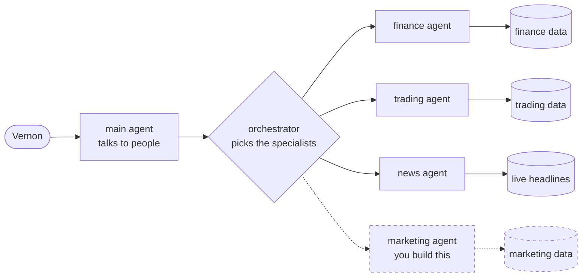
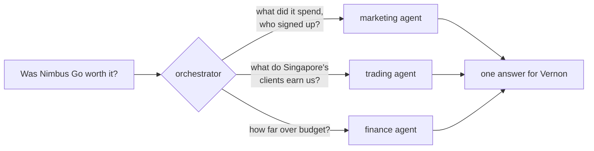

# The marketing agent workshop

Nimbus Markets is an online broker with an AI assistant built with
[Google ADK](https://google.github.io/adk-docs/). It answers questions about **finance**,
**trading** and the day's **market news**, but not about **marketing**. Vernon, who runs
marketing, needs answers by Friday.

In one hour you build the marketing agent, plug it into the assistant, score it on hard
questions, improve it, and submit it to a competition.

## The hour

| Time | What you do | Minutes |
|---|---|---|
| 0:00 | [Set up](#set-up). Read [the story](#the-story) while it builds | 10 |
| 0:10 | [Exercise 0: Meet Nimbus](exercises/0-meet-nimbus.md). See the problem | 4 |
| 0:14 | [Exercise 1: Give the data a voice](exercises/1-tools.md). Write two tools | 9 |
| 0:23 | [Exercise 2: Hire the marketing agent](exercises/2-agent.md). Build the agent | 6 |
| 0:29 | [Exercise 3: Join the team](exercises/3-orchestrator.md). Plug it in | 6 |
| 0:35 | [Exercise 4: Teamwork](exercises/4-teamwork.md). Route questions that cross teams | 7 |
| 0:42 | [Exercise 5: Prove it](exercises/5-evals.md). Score it, fix one failure, score again | 10 |
| 0:52 | Submit to the competition | 2 |
| 0:54 | Leaderboard, and Vernon's answer | 6 |

Each exercise ends with a check, like `make check-1`, and a link to the next one. If you fall
behind, open the hints: every exercise has one that shows the finished code.

## Before the session

These have to be on your laptop already. Installing them takes longer than the hour allows.

- **Docker Desktop or Podman**, installed and **running**.
- **`git`** and **`make`**. Macs and Linux have them. On Windows, use WSL.
- **A GitHub account**, to fork this repo and submit your work.
- **Some Python.** You'll write two short `async def` functions with type hints and docstrings,
  and fill in one function call. You don't need Python installed: everything runs in containers.

You also need an LLM key. A free Gemini key from
[Google AI Studio](https://aistudio.google.com/apikey) works, or use the one your facilitators
give you.

## Set up

**1. Get the code.** Fork this repo on GitHub, then clone your fork:

```bash
git clone <your fork's URL>
cd devfest_adk_multiagent
```

**2. Add your key.** Copy the settings file:

```bash
cp .env.example .env
```

Then open `.env`. Put a Gemini key after `GEMINI_API_KEY=`. If your facilitators gave you a key
and a URL instead, add `LLM_API_KEY=<key>` and `LLM_BASE_URL=<url>`.

**3. Start the app.**

```bash
make up
```

The first start takes a few minutes: it builds the app and loads the data. `make up` uses Docker
if you have it, and Podman otherwise. Read [the story](#the-story) while it runs.

**4. Open http://localhost:8080.** You should see the Overview page. Then start
[exercise 0](exercises/0-meet-nimbus.md).

## The story

Nimbus Markets is a fictional online broker with four companies: NM-UK, NM-SG (Singapore),
NM-AE (Dubai) and NM-INTL. Its AI assistant answers questions from the company's own data, and
finance and the trading desk use it every day.

In June, the Singapore team launched **Nimbus Go**, a new mobile app, and backed it with ad
campaigns. They spent fast. Singapore's marketing costs ran far over budget, and the CFO booked
a review for Friday with one question on the agenda: *was Nimbus Go worth the money?*

Vernon, who runs marketing, asked the assistant. It said no part of it knows about marketing.

The data team has done their part. They wrote and tested the queries over the marketing data
and left them in `my_agent/marketing_queries.py`, with a note: *"These return the right numbers.
We don't do agents. Over to you."*

You've just joined the AI team. Your job: give the assistant a marketing agent, so that by
Friday it can answer Vernon honestly.

## How the assistant works

The assistant has a main agent, an orchestrator and three specialists: finance, trading and
news. You add the fourth.



The main agent talks to people. The orchestrator reads each question, decides which specialists
it needs, asks them, and merges what they say. Each specialist knows one part of the business and
reads only its own data. The news agent reads live headlines; this workshop doesn't use it, but
it shows how many specialists one orchestrator can manage.

Vernon's question needs three of them at once:



## Where your work goes

Everything you write goes in one folder, `my_agent/`:

```
my_agent/
  marketing_agent.py      your two tools and your agent       exercises 1 and 2
  marketing_queries.py    the data team's queries; your tools call these
  team.py                 the agents the orchestrator can call    exercise 3
  prompts/
    marketing_agent.md    how your agent behaves                exercise 5
    orchestrator.md       how questions get routed              exercises 3 and 4
    main_agent.md         the assistant's persona               exercise 5
```

The rest of the app is in `platform/`. You never need to open it.

**How your changes show up.** You never restart anything. Save a file, and the app restarts
itself in about 2 seconds. Ask a question on the **Chat** page, and the **Agent route** panel
shows which agents and tools answered.

## Commands

| Command | What it does |
|---|---|
| `make up` | Start the app |
| `make check-1` | Check exercise 1 (or 0, 2, 3, 4) |
| `make eval` | Score your agents on the practice questions, in about 2 minutes |
| `make eval Q=<id>` | Score one question again |
| `make eval P=2` | Score more slowly, for a shared key or one that hits rate limits |
| `make submit` | Check your work is pushed, and show what to hand in |
| `make logs` | Show the app's logs. Use it when something breaks |
| `make reset` | Reload the database from scratch |
| `make down` | Stop the app |

The app is at http://localhost:8080. ADK's own developer UI, with the same agents, is at
http://localhost:8000.

## If something goes wrong

| Problem | Fix |
|---|---|
| `make up` says Docker or Podman isn't running | Start Docker Desktop, or run `podman machine start`. Then `make up` again. |
| `make up` stops and asks for a key | Add your key to `.env`, then `make up` again. |
| "port 5432 is already in use" | Another database is running. In `.env`, set `POSTGRES_PORT=5433`, then `make up` again. |
| The first `make up` is very slow | It downloads about 1 GB of images. Keep going with the story and exercise 0's reading. |
| The chat stops answering after you save a file | You have a Python error. Run `make logs`, fix it, save again. |
| `make eval` shows "rate limit" or many timeouts | Run `make eval P=2`. |
| The data looks wrong | Run `make reset`. |

## Going deeper

- [How the orchestrator picks agents](platform/docs/ORCHESTRATION.md)
- [How the app is built](platform/docs/ARCHITECTURE.md): containers, data model, tools and safety
- [Maintaining the app](platform/README.md): tests, data, judging, and the reference docs
