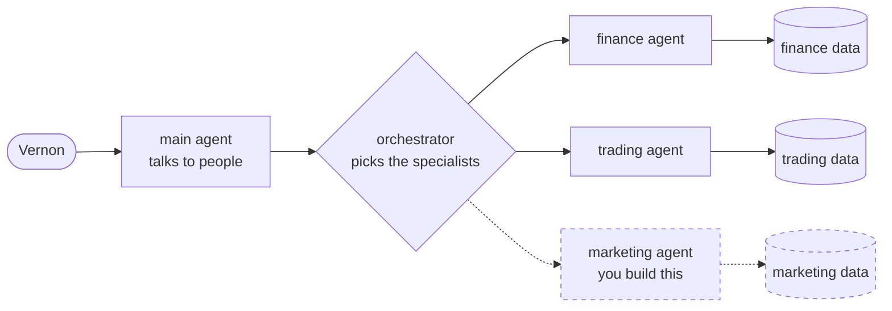
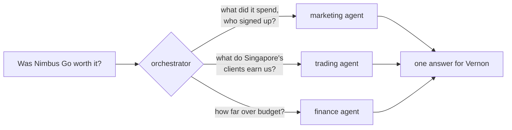

# The marketing agent workshop

## The story so far

Nimbus Markets is an online broker. Clients trade currencies, crypto, gold and stock indices
through four companies: Nimbus Markets UK in London, Nimbus Markets SG in Singapore, Nimbus
Markets AE in Dubai, and Nimbus Markets International for everyone else. Inside the company they
go by short codes: NM-UK, NM-SG, NM-AE and NM-INTL.

A few months ago the AI team shipped an assistant, built with
[Google ADK](https://google.github.io/adk-docs/). You type a question in plain English and it
answers from the company's own data. Finance uses it every morning for P&L and budgets. The
trading desk uses it for volumes and commission. It is the most popular tool in the building.

Then there's Vernon.

Vernon runs marketing. In June, the Singapore team launched **Nimbus Go**, a new mobile app, and
backed it with a wave of ad campaigns across search, social, video, app stores and affiliates.
The campaigns spent fast. Last week the CFO noticed that Singapore's marketing costs were running
far over budget, and booked a review for Friday. The question on the agenda is short: *was Nimbus
Go worth the money?*

Vernon opened the assistant and asked. The assistant said, politely, that no part of it knows
anything about marketing. Vernon asked again with different words. Same answer.

The data team has already done their part. They wrote and tested five queries over the marketing
data and left them in `marketing_queries.py`, with a note: *"These return the right numbers. We
don't do agents. Over to you."*

That's where you come in. You've just joined the AI team, and your first job is to give the
assistant a marketing agent. When you're done, Vernon should be able to ask about campaigns in
plain English. The assistant should also answer the questions that matter on Friday: how many
clients Nimbus Go brought in, what each one cost, how much commission Singapore's clients bring
in, and how far over budget Singapore really is. Those need marketing, trading and finance data
together.

Then the competition starts. The AI team has a set of hard questions waiting. Some are lookups,
some need real analysis, some cross three teams, and a few are traps. The best agent wins.

## How the assistant could work

Today the assistant has a main agent, an orchestrator and two specialists. You add the third.



The main agent talks to people. The orchestrator reads each question, decides which specialists
it needs, asks them, and merges what they say. Each specialist knows one part of the business and
reads only its own data.

The interesting questions need more than one specialist:



## Before you start

You need Docker, `make`, `git`, and an LLM key. A free Gemini key from
[Google AI Studio](https://aistudio.google.com/apikey) works, or use the key your facilitators give
you.

```bash
git clone <your fork's URL>
cd devfest_adk_multiagent
cp .env.example .env
```

Put your key in `.env` (after `GEMINI_API_KEY=`), then start everything:

```bash
make up
```

The first start takes a few minutes. When it's done, open http://localhost:8080.

## The exercises

| | Exercise | You'll end up with | About |
|---|---|---|---|
| 0 | [Meet Nimbus](exercises/0-meet-nimbus.md) | The app running, and Vernon's problem in front of you | 5 min |
| 1 | [Give the data a voice](exercises/1-tools.md) | Two tools Gemini can call | 10 min |
| 2 | [Hire the marketing agent](exercises/2-agent.md) | An agent that uses them | 7 min |
| 3 | [Join the team](exercises/3-orchestrator.md) | The orchestrator sends marketing questions to your agent | 8 min |
| 4 | [Teamwork](exercises/4-teamwork.md) | Questions that need two or three agents get the right ones | 8 min |
| 5 | [Prove it](exercises/5-evals.md) | A score, and the competition | the rest |

Every exercise ends with a check you can run, like `make check-1`. It tells you what works and
what doesn't yet.

You can also score your agents at any point with `make eval`, even before you've written a line.
The score starts low. Watching it climb is half the fun.

Start with **[exercise 0](exercises/0-meet-nimbus.md)**.
