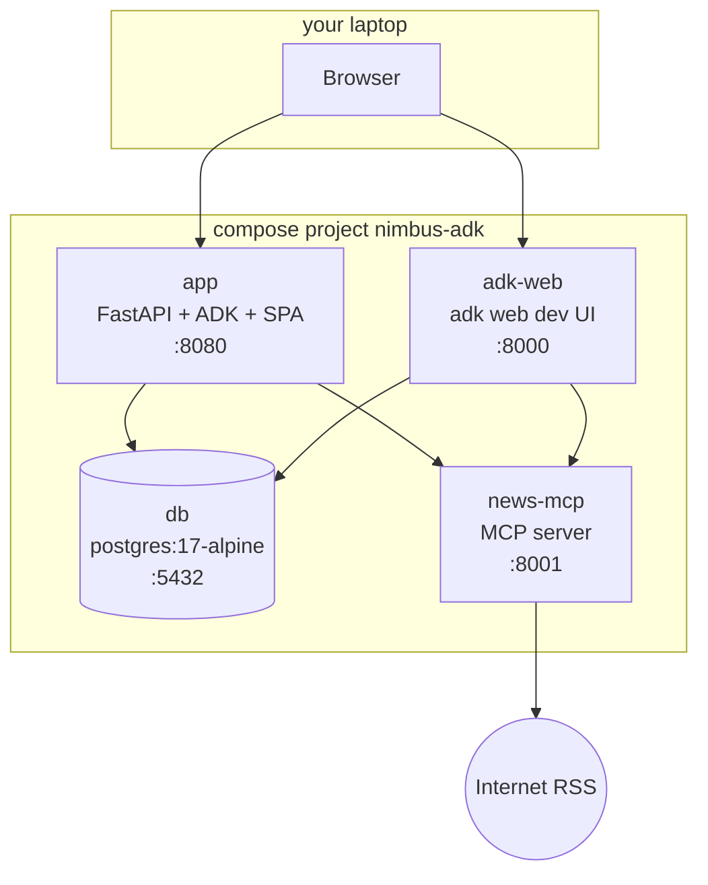
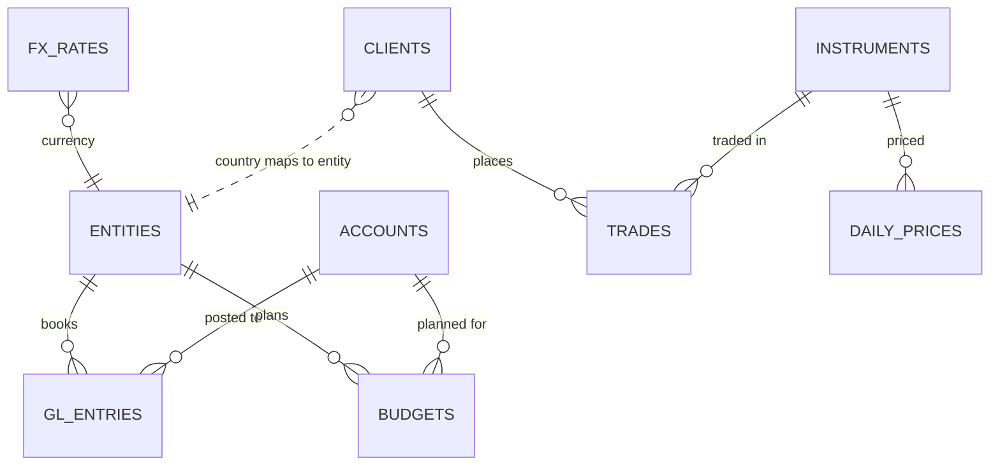

# Architecture

This demo re-implements a production-style pattern, **agents whose tools live in a database
registry**, as a small, self-contained Google ADK app. On top of it sits a three-tier multi-agent
hierarchy. Everything runs in four containers. All business data is synthetic.

## Containers

| Service | Image | Notes |
|---|---|---|
| `db` | `postgres:17-alpine` | `./db/init` → `/docker-entrypoint-initdb.d` (run once on an empty volume), `./db/seed` → `/seed:ro`. Healthcheck: `pg_isready -h 127.0.0.1`. This only passes after init has finished, because the init-time server listens on the unix socket only. |
| `news-mcp` | `docker/news-mcp.Dockerfile` | Python 3.13 slim, installs only the `news` dependency group from `uv.lock`. Serves `/mcp` (stateless streamable HTTP) and `/healthz`. |
| `app` | `docker/app.Dockerfile` | Stage 1 (`node:22`) builds `web/` → `web/dist`. Stage 2 (Python 3.13 + uv) runs `uv sync --frozen --no-dev` and copies `src/`, `seed/` and the SPA to `/app/static`. Runs as non-root. `uvicorn devfest_agents.api.main:app` on 8080. |
| `adk-web` | same image as `app` | `adk web --host 0.0.0.0 --port 8000 /app/src/devfest_agents/adk_apps`. The `nimbus` app exports the same `root_agent`. |

`app` and `adk-web` read `.env` (`env_file`) for the LLM key and model. Compose sets the
service-to-service URLs (`DATABASE_URL`, `AGENT_DATABASE_URL`, `NEWS_MCP_URL`). They wait for
`db` to be healthy, and the app also retries its DB connection on its own.

## Data model

There is one database (`nimbus`) with three schemas. Every table and column has a `COMMENT ON`, and
the Schema page renders those comments live, so the docs can't drift from the DB. The comments state
units, sign conventions, join keys and enum values.

**`finance`**: `entities` (NM-UK GBP, NM-SG SGD, NM-AE AED, NM-INTL USD), `accounts` (fictional
chart: 4xxx revenue, 5xxx expense), `fx_rates` (daily, 1 unit = `usd_rate` USD), `gl_entries` (about
16k P&L lines; **revenue and expense both stored as positive magnitudes**, `account_type` decides the
sign), and `budgets` (month × entity × account).

**`trading`**: `clients` (600; segment retail/pro/vip, risk level), `instruments` (16 generic public
symbols: FX pairs, BTC/ETH, gold/silver/oil, broad indices; no single-company stocks), `trades`
(about 20k; `notional_usd`, `commission_usd` = Nimbus revenue, `pnl_usd` = client result) and
`daily_prices` (random-walk OHLC).

**`tools`**: `tools` (the registry) and `tool_runs` (an execution log). See [the registry](#the-tool-registry).

**Finance ↔ trading link.** A client's `country` decides the booking entity: GB→NM-UK;
SG/MY/TH/ID/VN/PH→NM-SG; AE/SA/QA/KW/BH/OM→NM-AE; anything else→NM-INTL. For every month and
entity, GL account 4100 (Trading commission) equals `SUM(trades.commission_usd)` of that entity's
closed trades, bucketed by `close_time`. The two differ only by cents of FX rounding, because the GL
books in local currency and re-translates to USD. That is why cross-agent questions give consistent
answers.

**Roles.**

| Role | Can do |
|---|---|
| `postgres` | Superuser. Runs the init scripts. |
| `app` | Owns `tools` (read/write). Has `SELECT` on finance/trading for the schema browser and sample rows. |
| `agent_ro` | `SELECT` on finance/trading **only**. No access to `tools`. `default_transaction_read_only=on`, `statement_timeout=5s`, empty `search_path` (so table names must be schema-qualified). Every agent tool query runs as this role. |

### Synthetic data generation
`scripts/generate_synthetic_data.py` is deterministic (fixed seed, stdlib only). It writes
`db/seed/*.csv`, which are committed and simply `COPY`'d at first start, so there is no ETL. It plants
four storylines (crypto spike, revenue miss, marketing overrun, commission reconciliation), which are
described in its docstring and in [DEMO_SCRIPT.md](DEMO_SCRIPT.md). `make data` regenerates the CSVs
(the window ends at the current month). Then run `make reset` to reload them.

## The tool registry

A tool is a row in `tools.tools`:

| `tool_type` | Stored | LLM-facing signature | Returns |
|---|---|---|---|
| `sql` | `sql_text` with `:name` placeholders + `params` (jsonb specs: type, required, enum, default, min/max, example) | one typed argument per param | `{tool, params, row_count, truncated, rows, summary}` |
| `factual` | `answer_text` (markdown) + `source` | no arguments | `{answer, source}` |

How a row becomes an ADK tool (`src/devfest_agents/tools/`):

1. **Spec + validation** (`spec.py`). Unknown keys are rejected and placeholders must match the
   declared params exactly. Name, type, enum and range rules are checked.
2. **SQL guard** (`sql_guard.py`). The query must be a single `SELECT`/`WITH` statement. It may only
   reference its own agent's schema, with fully schema-qualified tables, and no DDL or DML.
3. **Factory** (`factory.py`). A Python function is generated with a real `__signature__`, typed
   `__annotations__` and a rendered `__doc__`, then wrapped in an ADK `FunctionTool`. The function
   declaration the LLM sees therefore comes straight from the row.
4. **Executor** (`executor.py`). `:name` placeholders are converted to driver placeholders with
   explicit casts by param type, so optional params bound as NULL are typed correctly. The query runs
   as `agent_ro` in a read-only transaction with a statement timeout, wrapped in
   `LIMIT max_rows + 1` so truncation can be flagged. Errors come back as `{"error": ...}`, so the
   model can correct itself.
5. **Hot reload** (`toolset.py`). `SqlRegistryToolset(agent=...)` is an ADK `BaseToolset`. Its
   `get_tools()` runs a cheap fingerprint query (`count(*)`, `max(updated_at)` for that agent's
   enabled tools) and rebuilds only when the fingerprint changes. A trigger keeps `updated_at` fresh.
   Create a tool in the UI and the next question sees it, with no restart.

**Seeding.** At startup the app reads `seed/starter_tools.yaml`, validates each entry with the same
spec and guard, and inserts the missing ones (`ON CONFLICT DO NOTHING`), so edits made in the UI
survive restarts. `make seed-tools` forces a re-upsert from the YAML.

## News MCP server

`news_mcp/server.py` uses the `mcp` SDK (`MCPServer`, the v2 name of `FastMCP`) over stateless
streamable HTTP. A background **news listener** task polls five Google News RSS topic searches
(markets, crypto, forex, commodities, economy) every `NEWS_POLL_SECONDS` into an in-memory rolling
buffer. It exposes three tools:

- `latest_headlines(topic, limit)`: newest headlines for a topic, from the buffer.
- `search_news(query, limit)`: a live Google News RSS search, cached for 5 minutes. If the live
  search fails, it falls back to a keyword search of the buffer.
- `list_feeds()`: the polled feeds with item counts and last poll times.

All three fail soft. When offline they return a single `{"note": "..."}` item instead of raising, so
the news agent can say that live news is unavailable. The app's `news_agent` connects with ADK's
`McpToolset`.

## Request flow and live route visualisation

`AgentTool` runs each child agent inside a nested runner, so the outer event stream never shows the
specialists' work. Instead, every agent gets ADK callbacks (`before/after_agent`,
`before/after_tool`) that push trace events into a per-request sink. The sink is held in a
`contextvars.ContextVar`, which nested runs and parallel tool calls inherit. `POST /api/chat`
streams those events as SSE:

- `agent_start` / `agent_end`;
- `tool_call` / `tool_result`, where `kind` is `agent` for a delegation edge, or `sql` / `factual` /
  `mcp` for a leaf tool;
- `answer`, which includes the `route`.

The SPA animates the route graph from these events. A parallel fan-out shows up as several
`tool_call`s before their results.

## Safety summary

- The LLM never writes SQL at question time. It can only call registered, reviewed and tested queries
  with validated arguments.
- Defence in depth: the SQL guard (single SELECT, own schema only), the read-only `agent_ro` role
  with no access to the registry, read-only transactions, a 5 s statement timeout and a row cap.
- The orchestrator caps delegations per turn and blocks recursion (see
  [ORCHESTRATION.md](ORCHESTRATION.md)).
- The LLM key comes only from `.env`. It is never committed, baked into an image, or sent to the
  browser: `/api/health` only reports "configured / missing".
