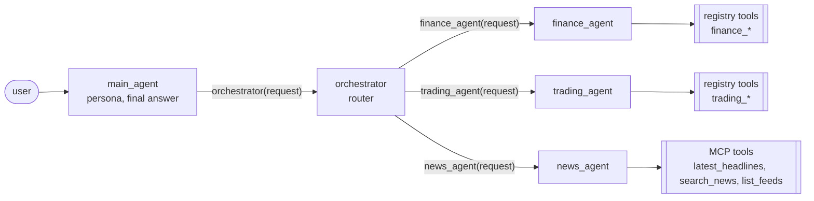

# How the orchestrator classifies and fans out

**Short version: there is no separate classifier.** Routing is the orchestrator LLM choosing which
function calls to make. Each specialist agent is exposed to it as a function through ADK's
`AgentTool`.

## Three tiers

| Agent | Tools | Job |
|---|---|---|
| `main_agent` (root) | `AgentTool(orchestrator)` | Persona. Answers greetings and meta questions itself ("what can you do?"). Anything about data or news goes to the orchestrator, and it writes the final user-facing answer. |
| `orchestrator` | `AgentTool(finance_agent)`, `AgentTool(trading_agent)`, `AgentTool(news_agent)` | Decides **which** specialists are needed, **what** to ask each, and **in which order**. Then it merges and attributes their findings. |
| `finance_agent` / `trading_agent` | `SqlRegistryToolset("finance")` / `SqlRegistryToolset("trading")` | Answer with tool results only, from their own schema. |
| `news_agent` | `McpToolset` → news-mcp | Real-world market context. It has no Nimbus data. |

## Classification = function calling

1. **The function list.** ADK turns each `AgentTool` into a function declaration named after the
   agent, for example `trading_agent(request: str)`. The specialist's `description` becomes the
   function description. The model sees three functions with clear, non-overlapping descriptions.
2. **The instruction.** This is a callable that is re-evaluated **every turn**, so it is never stale.
   It contains:
   - **today's date**, so "last month" and "Q3" resolve correctly;
   - **routing rules**:
     - finance = GL, P&L, budgets, FX, entities;
     - trading = clients, trades, instruments, prices, commission earned per trade;
     - news = market headlines and events;
     - plus tie-breakers, such as *"commission booked as revenue is finance, commission earned per
       trade/instrument/client is trading"*;
   - **a live capability catalogue**: each specialist's currently enabled tools (name + title), read
     from the registry. When you register `finance_fx_rates` in the UI, the orchestrator's next
     instruction lists it, so the new tool improves **routing** as well as the specialist.
3. **The decision.** The model answers with zero or more function calls. Zero means it answers
   directly or says no specialist fits.

## Fan-out patterns

**Parallel (independent sub-questions).** The model emits several function calls in **one** response.
ADK runs those `AgentTool` calls concurrently. In the route panel you see two or three `tool_call`
edges light up before any result returns.

> "Does the commission revenue we booked in Q3 match what the trading desk earned?"
> → `finance_agent("Trading commission revenue booked per month, Jul-Sep 2026")` **and**
> `trading_agent("Commission earned per month on closed trades, Jul-Sep 2026")` in the same step.

**Sequential (dependent sub-questions).** When one answer needs another, the orchestrator calls the
first specialist, reads the result, and only then calls the next one with what it learned. This is
just more turns of the same tool loop, with no special workflow agent.

> "Which instrument drove the most commission last month, and what's in the news about it?"
> → `trading_agent("Top instrument by commission in October 2026")` → reads "Bitcoin" →
> `news_agent("Latest news about Bitcoin")`.

**Mixed.** A question can combine both patterns, for example "Why did we miss revenue budget in
August?":

1. finance: budget vs actual for Aug 2026;
2. trading: activity for Jul-Sep 2026;
3. news: what the market was doing then.

The orchestrator may run steps 1 and 2 in parallel, then ask news a targeted question.

**Rewritten sub-questions.** Each call carries a **self-contained** question with explicit dates
("October 2026", "2026-07-01 to 2026-09-30"), never the raw user text. Specialists don't see the
conversation, so they must not need it.

**Merging.** The orchestrator attributes every fact ("Finance: ...", "Trading: ...",
"News: ..."), keeps numbers exactly as the specialists returned them, and compares figures that
should agree (booked vs earned commission) and states the difference.

## Guardrails

| Guardrail | Where |
|---|---|
| **Delegation cap**: at most `MAX_DELEGATIONS` (default 4) specialist calls per orchestrator turn. Extra calls are skipped, and the model receives an error telling it to answer with what it has. | `before_tool_callback` (`tracing.DelegationGuard`) |
| **No recursion**: an agent cannot delegate to itself. | same callback |
| **No guessing**: if no specialist or tool fits, the orchestrator says so and suggests registering a tool. | orchestrator instruction |
| **Numbers only from tools**: specialists may only state figures that appear in their tool results. | specialist instructions |
| **Data access**: specialists can only run registered SQL tools, as `agent_ro`, on their own schema. | tool registry + SQL guard + DB role |
| **News fails soft**: if news-mcp is down, the news agent says live news is unavailable instead of failing the whole answer. | MCP server + fail-soft toolset |

## Models

Every agent uses ADK's `LiteLlm` wrapper. `AGENT_MODEL` drives the specialists. The optional
`ROUTER_MODEL` lets `main_agent` and the orchestrator run on a faster or cheaper model, because
routing needs less reasoning than analysis. Two modes are supported:

- **direct Gemini**: `GEMINI_API_KEY`, `gemini/...` model strings;
- **OpenAI-compatible LiteLLM proxy**: `LITELLM_GEMINI_API_KEY` + `OPENAI_BASE_URL`, `openai/...`
  model strings.

## Seeing it live

- **Chat page** (:8080): the right-hand Agent Route panel animates `main_agent → orchestrator →
  specialists → tools`, with numbered steps and a timeline of arguments and results.
- **ADK dev UI** (:8000): pick `nimbus` to inspect the same agents with ADK's own event and trace
  viewer. It shows the outer events. Nested `AgentTool` runs appear as single tool calls, which is
  exactly why the app adds its own callback-based tracing.
