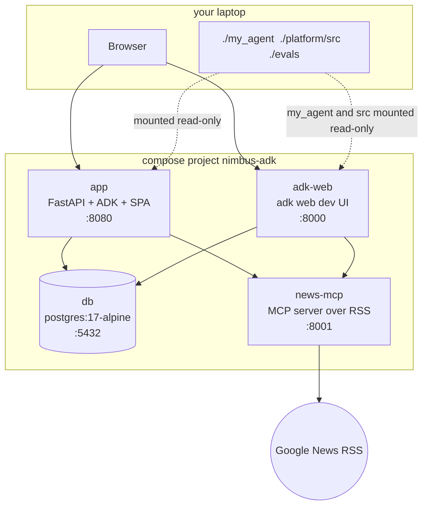
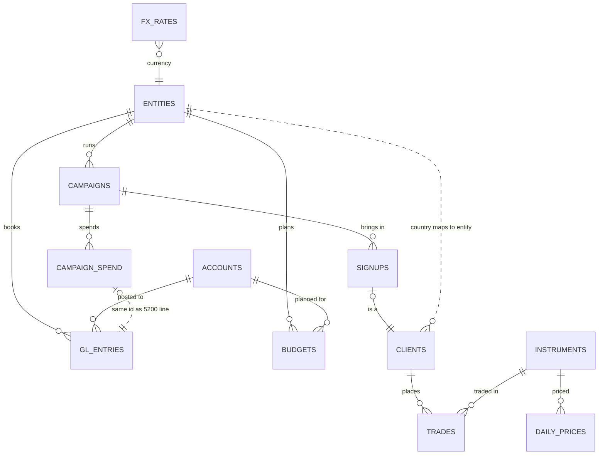

# Architecture

This repo re-implements a production-style pattern, **agents whose tools live in a database
registry**, as a small, self-contained Google ADK app. On top of it sits a three-tier multi-agent
hierarchy. In the workshop you add one more specialist, a marketing agent whose Python tools wrap
queries the data team already wrote (see [the README](../../README.md)). Everything runs in four
containers. All business data is synthetic.

## Containers



| Service | Image | Notes |
|---|---|---|
| `db` | `postgres:17-alpine` | `./db/init` → `/docker-entrypoint-initdb.d` (run once on an empty volume), `./db/seed` → `/seed:ro`. Healthcheck: `pg_isready -h 127.0.0.1`. This only passes after init has finished, because the init-time server listens on the unix socket only. |
| `app` | `docker/app.Dockerfile` (build context: the repo root) | Stage 1 (`node:22`) builds `web/` → `web/dist`. Stage 2 (Python 3.13 + uv) runs `uv sync --frozen --no-dev` in `/app/platform`, and copies `src/`, `seed/`, `my_agent/` and the SPA. `/app` mirrors the repo (`/app/platform/src`, `/app/my_agent`, `/app/evals`) and `PYTHONPATH=/app` makes `my_agent` importable. Runs as non-root. `uvicorn devfest_agents.api.main:app --reload` on 8080, watching `/app/platform/src` and `/app/my_agent`. `./platform/src`, `./my_agent` and `./evals` are mounted read-only at the same paths. |
| `news-mcp` | `docker/news-mcp.Dockerfile` | `python -m news_mcp.server` on 8001 (`/mcp`, `/healthz`). Installs only the `news` dependency group. A background listener polls Google News RSS topic searches every `NEWS_POLL_SECONDS` into an in-memory buffer. Tools: `latest_headlines`, `search_news`, `list_feeds`. When the internet is unreachable they return a note instead of raising. |
| `adk-web` | same image as `app` | `adk web --host 0.0.0.0 --port 8000 --reload_agents /app/platform/src/devfest_agents/adk_apps`. The `nimbus` app exports the same `root_agent`. Mounts `./platform/src` and `./my_agent` like `app`. |

`app` and `adk-web` read `.env` (`env_file`) for the LLM key and model. Compose sets the
service-to-service URLs (`DATABASE_URL`, `AGENT_DATABASE_URL`, `NEWS_MCP_URL`). They wait for `db` to be healthy, and
the app also retries its DB connection on its own.

**Live reload.** Because `./platform/src` and `./my_agent` are mounted over the copies in the image, a Python edit on your laptop
reaches both containers straight away. The app's uvicorn restarts on change
(`WATCHFILES_FORCE_POLLING=true`, because file events don't always cross the Docker VM
boundary), and `adk web --reload_agents` reloads the agents. You only rebuild the image when
dependencies or the SPA change.

## Data model

There is one database (`nimbus`) with four schemas. Every table and column has a `COMMENT ON`, and
the Schema page renders those comments live, so the docs can't drift from the DB. The comments state
units, sign conventions, join keys and enum values.



**`finance`**: `entities` (NM-UK GBP, NM-SG SGD, NM-AE AED, NM-INTL USD), `accounts` (fictional
chart: 4xxx revenue, 5xxx expense), `fx_rates` (daily, 1 unit = `usd_rate` USD), `gl_entries` (about
16k P&L lines; **revenue and expense both stored as positive magnitudes**, `account_type` decides the
sign), and `budgets` (month × entity × account).

**`trading`**: `clients` (600; segment retail/pro/vip, risk level), `instruments` (16 generic public
symbols: FX pairs, BTC/ETH, gold/silver/oil, broad indices; no single-company stocks), `trades`
(about 20k; `notional_usd`, `commission_usd` = Nimbus revenue, `pnl_usd` = client result) and
`daily_prices` (random-walk OHLC).

**`marketing`**: `campaigns` (117; one channel for one entity for one quarter, named like
"NM-UK Q3 2026 - search ads"; from June 2026 NM-SG runs the "Nimbus Go launch - <channel>" campaigns),
`campaign_spend` (276 ad invoices with `spend_usd`, `impressions` and `clicks`) and `signups` (195 new
clients credited to the campaign that brought them in). About half of all new clients come from a
campaign; the rest are only in `trading.clients`.

**`tools`**: `tools` (the registry) and `tool_runs` (an execution log). See [the registry](#the-tool-registry).

**Finance ↔ trading link.** A client's `country` decides the booking entity: GB→NM-UK;
SG/MY/TH/ID/VN/PH→NM-SG; AE/SA/QA/KW/BH/OM→NM-AE; anything else→NM-INTL. For every month and
entity, GL account 4100 (Trading commission) equals `SUM(trades.commission_usd)` of that entity's
closed trades, bucketed by `close_time`. The two differ only by cents of FX rounding, because the GL
books in local currency and re-translates to USD.

**Marketing ↔ finance link.** Every GL line on account 5200 (Performance marketing) is one
`marketing.campaign_spend` row with the same id (`spend_id` = `entry_id`) and the same USD amount, so
campaign spend reconciles with the ledger to the cent. The GL **Marketing** category is wider: it also
holds 5210 (Brand and events) and 5220 (Introducing-partner commissions), which have no campaign.

**Marketing ↔ trading link.** `signups.client_id` is a `trading.clients.client_id`, and
`signup_date` equals the client's `signup_date`. These links are why cross-agent questions give
consistent answers.

**Roles.**

| Role | Can do |
|---|---|
| `postgres` | Superuser. Runs the init scripts. |
| `app` | Owns `tools` (read/write). Has `SELECT` on finance, trading and marketing for the schema browser and sample rows. |
| `agent_ro` | `SELECT` on finance, trading and marketing **only**. No access to `tools`. `default_transaction_read_only=on`, `statement_timeout=5s`, empty `search_path` (so table names must be schema-qualified). Every agent tool query runs as this role. |

### Synthetic data generation
`scripts/generate_synthetic_data.py` is deterministic (fixed seed, stdlib only). It writes
`db/seed/*.csv`, which are committed and simply `COPY`'d at first start, so there is no ETL. It plants
five storylines (crypto spike, revenue miss, marketing overrun, commission reconciliation, the Nimbus Go
campaign), which are described in its docstring and in [DEMO_SCRIPT.md](DEMO_SCRIPT.md). The marketing
CSVs are built from the GL's 5200 lines with their own RNG, so adding them did not change the finance
and trading CSVs. `make -C platform data` regenerates the CSVs (the window ends at the current month). Then run
`make reset` to reload them.

## Specialists

Each specialist is a module in `src/devfest_agents/agents/` with the same small interface:

| Name | Meaning |
|---|---|
| `NAME` | Agent name, e.g. `finance_agent`. Also the function name the orchestrator calls. |
| `LABEL` | Display name for the UI, e.g. `Finance agent`. |
| `DATASOURCE` | The schema it reads, e.g. `finance`, or `internet` for the news agent. |
| `DESCRIPTION` | What it answers. Becomes the `AgentTool` description the orchestrator routes on. |
| `build(services, model)` | Returns the ADK `LlmAgent`. |

`my_agent/team.py` holds the list. At the start of the workshop it is
`SPECIALISTS = [finance_agent, trading_agent, news_agent]`, and you add `marketing_agent`. Everything else follows
from that list: `build_root_agent` builds each specialist, attaches tracing to it and hands them all to
the orchestrator; `graph_agents()` builds the `/api/graph` topology, so the new agent appears on the
Overview diagram and in the route panel without any frontend change.

The finance and trading agents are built by `build_registry_specialist` (`agents/specialists.py`):
an `LlmAgent` whose only tool is a `SqlRegistryToolset` for its schema. The news agent's only tool
is a `NewsToolset` (`tools/news_toolset.py`), a fail-soft wrapper around ADK's `McpToolset` for the
news-mcp server: when the server is down, the agent gets no tools for a 30-second back-off and says
news is unavailable, instead of the whole question failing. The marketing agent uses
Python function tools instead. `my_agent/marketing_agent.py` starts as a stub with `Exercise 1` and
`Exercise 2` comments: `DESCRIPTION` is empty and `build()` raises `NotImplementedError` until a
participant finishes it.

**What participants edit.** Everything a participant touches is in `my_agent/` at the repo root:
the marketing agent and the data team's queries, `team.py` (the `SPECIALISTS` list, imported by
`agents/__init__.py`), and the prompts for the main agent, the orchestrator and the marketing
agent. `load_prompt` looks in `my_agent/prompts/` first, then in `agents/prompts/` for the finance
and trading prompts.

## The tool registry

The finance and trading agents get their tools from the registry. A tool is a row in `tools.tools`:

| `tool_type` | Stored | LLM-facing signature | Returns |
|---|---|---|---|
| `sql` | `sql_text` with `:name` placeholders + `params` (jsonb specs: type, required, enum, default, min/max, example) | one typed argument per param | `{tool, params, row_count, truncated, rows, summary}` |
| `factual` | `answer_text` (markdown) + `source` | no arguments | `{answer, source}` |

How a row becomes an ADK tool (`src/devfest_agents/tools/`):

1. **Spec + validation** (`spec.py`). Unknown keys are rejected and placeholders must match the
   declared params exactly. Name, type, enum and range rules are checked.
2. **SQL guard** (`sql_guard.py`). The query must be a single `SELECT`/`WITH` statement. It may only
   reference its own agent's schema, with fully schema-qualified tables, and no DDL or DML.
3. **Factory** (`factory.py`). A Python function is generated with a real `__signature__`, typed
   `__annotations__` and a rendered `__doc__`, then wrapped in an ADK `FunctionTool`. The function
   declaration the LLM sees therefore comes straight from the row.
4. **Executor** (`executor.py`). `:name` placeholders are converted to driver placeholders with
   explicit casts by param type, so optional params bound as NULL are typed correctly. The query runs
   as `agent_ro` in a read-only transaction with a statement timeout, wrapped in
   `LIMIT max_rows + 1` so truncation can be flagged. Errors come back as `{"error": ...}`, so the
   model can correct itself.
5. **Hot reload** (`toolset.py`). `SqlRegistryToolset(agent=...)` is an ADK `BaseToolset`. Its
   `get_tools()` runs a cheap fingerprint query (`count(*)`, `max(updated_at)` for that agent's
   enabled tools) and rebuilds only when the fingerprint changes. A trigger keeps `updated_at` fresh.
   Create a tool in the UI and the next question sees it, with no restart.

**Seeding.** At startup the app reads `seed/starter_tools.yaml`, validates each entry with the same
spec and guard, and inserts the missing ones (`ON CONFLICT DO NOTHING`), so edits made in the UI
survive restarts. `make -C platform seed-tools` forces a re-upsert from the YAML.

The registry and the UI tool editor cover **finance and trading only** (`tools.agent` is
`finance` or `trading`). Marketing tools live in Python.

## Python function tools and `run_sql`

The marketing agent's tools are plain async Python functions. ADK wraps each one in a `FunctionTool`:
the function name, the typed signature and the docstring become the declaration the LLM sees.

Participants don't write SQL. In the story, the data team has already written and tested five queries
in `my_agent/marketing_queries.py`:

| Function | Returns |
|---|---|
| `fetch_campaign_performance(start_date, end_date, entity_id=None)` | one row per campaign: spend, impressions, clicks, sign-ups, cost per sign-up |
| `fetch_channel_summary(start_date, end_date, entity_id=None)` | one row per ad channel, with click-through rate |
| `fetch_monthly_spend(start_date, end_date, entity_id=None, channel=None)` | one row per month |
| `fetch_entity_summary(start_date, end_date)` | one row per entity that ran campaigns |
| `fetch_campaigns(entity_id=None, name_contains=None)` | the campaign list with start and end dates |

They have developer comments, not docstrings, so a model can't use them well as they are. The
participant's job is to wrap them as tools written for the model:

```python
async def channel_summary(start_date: str, end_date: str, entity_id: str | None = None) -> dict:
    """Spend, clicks and sign-ups per ad channel for a date range.

    Args:
        start_date: First day, YYYY-MM-DD.
        end_date: Last day (inclusive), YYYY-MM-DD.
        entity_id: Only campaigns of this entity: NM-UK, NM-SG, NM-AE or NM-INTL. Omit for all.
    """
    return await queries.fetch_channel_summary(start_date, end_date, entity_id)
```

Each query reads the database through `run_sql` (`src/devfest_agents/tools/sql_query.py`).
`run_sql(schema, sql, **params)` gives Python tools the same safety as registry tools:

- `:name` placeholders, bound from the keyword arguments. A missing value is reported, not guessed.
  There are no declared types, so Postgres infers each parameter from where it is used. A bare NULL
  check needs a cast: `(:entity_id::text IS NULL OR c.entity_id = :entity_id)`.
- the same SQL guard: single `SELECT`/`WITH`, only the given schema, schema-qualified tables;
- the same executor: the `agent_ro` role, a read-only transaction, the 5 s statement timeout and the
  row cap (`TOOL_MAX_ROWS`);
- problems come back as `{"error": "..."}`. Success is `{"row_count", "truncated", "rows"}`.

Python tools are not hot-reloaded from the database. They change when the code changes, which the
mounted `./my_agent` and the reloading containers make just as quick.

## Request flow and live route visualisation

`AgentTool` runs each child agent inside a nested runner, so the outer event stream never shows the
specialists' work. Instead, every agent gets ADK callbacks (`before/after_agent`,
`before/after_tool`) that push trace events into a per-request sink. The sink is held in a
`contextvars.ContextVar`, which nested runs and parallel tool calls inherit. `POST /api/chat`
streams those events as SSE:

- `agent_start` / `agent_end`;
- `tool_call` / `tool_result`, where `kind` is `agent` for a delegation edge, or `sql` / `factual` /
  `function` for a leaf tool (`function` = a Python tool, shown as "Python" in the route panel);
- `answer`, which includes the `route`.

The SPA animates the route graph from these events. A parallel fan-out shows up as several
`tool_call`s before their results. Tracing is attached to every agent in `SPECIALISTS`, so a new
specialist shows up in the route with no extra work.

## Workshop checks

`make check-N` (N = 0 to 4) runs `src/devfest_agents/check.py` inside the `app` container. It prints
a checklist for one exercise, with ✓ or ✗ per item and a hint for every ✗:

| Check | What it looks at |
|---|---|
| `check-0` | the LLM key is set and the marketing data is loaded |
| `check-1` | `my_agent/marketing_agent.py` has at least two tools, each with a docstring and type hints; ADK can turn each into a tool; each returns data for Q3 2026 |
| `check-2` | `DESCRIPTION` is filled in; `build()` returns an `LlmAgent` named `marketing_agent` with an instruction and its tools |
| `check-3` | `marketing_agent` is in `SPECIALISTS`, the orchestrator can call it, `orchestrator.md` mentions it, and one live question routes to it |
| `check-4` | three live practice questions route to the right agents |

The live checks use the eval scorer, so they need the LLM key.

## Evals

`make eval` runs `src/devfest_agents/evals.py` inside the `app` container over
`evals/practice.yaml` (18 questions). Questions run in parallel, 4 at a time by default. A results
table goes to stderr and the JSON report to `evals/report.json`. Each question runs as a fresh
conversation and is worth 2 points:

- **route**: the orchestrator called exactly the agents listed for the question (none, for some);
- **answer**: every check on the question passes: expected numbers (within 1%), expected words,
  phrases that must not appear, and for some questions a one-line rule checked by an LLM judge.

The scorer reads the same trace events as the route panel, so routing is judged on what the
orchestrator actually called.

Setup problems stop the run with one plain message instead of a stack trace: no LLM key, a
`marketing_agent` in `SPECIALISTS` whose `build()` still raises `NotImplementedError`, or agents that
fail to build. If `marketing_agent` isn't wired in yet, the run goes ahead with a note that marketing
questions will fail, so participants can score from the very start.

`make eval-final KEY=<passphrase>` runs the hidden competition set, `evals/final.enc`. It is
encrypted, and the facilitators reveal the passphrase when the competition starts. For this set the
table and report show only ids, kinds and points. The plaintext `evals/final.yaml` is gitignored and
never committed. See the Evals section of [CONTRACT.md](CONTRACT.md) for the formats.

## Safety summary

- The LLM never writes SQL at question time. It can only call registered, reviewed and tested queries
  or Python tools that wrap the data team's fixed queries, with validated arguments.
- Defence in depth: the SQL guard (single SELECT, own schema only), the read-only `agent_ro` role
  with no access to the registry, read-only transactions, a 5 s statement timeout and a row cap. These
  apply to registry tools and to `run_sql` alike.
- The orchestrator caps delegations per turn and blocks recursion (see
  [ORCHESTRATION.md](ORCHESTRATION.md)).
- The LLM key comes only from `.env`. It is never committed, baked into an image, or sent to the
  browser: `/api/health` only reports "configured / missing".
