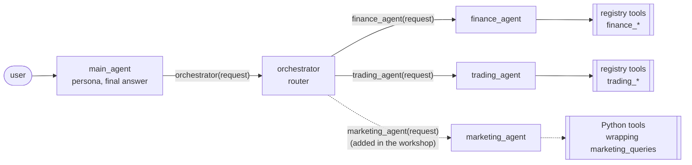

# How the orchestrator classifies and fans out

**Short version: there is no separate classifier.** Routing is the orchestrator LLM choosing which
function calls to make. Each specialist agent is exposed to it as a function through ADK's
`AgentTool`.

## Three tiers

| Agent | Tools | Job |
|---|---|---|
| `main_agent` (root) | `AgentTool(orchestrator)` | Persona. Answers greetings and meta questions itself ("what can you do?"). Every question about Nimbus data or the business goes to the orchestrator, even when it is not sure a specialist covers it. It writes the final user-facing answer. |
| `orchestrator` | one `AgentTool` per entry in `SPECIALISTS` | Decides **which** specialists are needed, **what** to ask each, and **in which order**. Then it merges and attributes their findings. |
| `finance_agent` / `trading_agent` | `SqlRegistryToolset("finance")` / `SqlRegistryToolset("trading")` | Answer with tool results only, from their own schema. |
| `marketing_agent` (you add it) | async Python functions that wrap the data team's queries in `marketing_queries.py`, which call `run_sql("marketing", ...)` | Campaign spend, impressions, clicks, sign-ups and cost per sign-up, from the `marketing` schema. |

The orchestrator only knows the specialists in `SPECIALISTS` (`my_agent/team.py`).
Until `marketing_agent` is in that list, a campaign question either goes to finance (which only sees
marketing costs as booked in the ledger) or gets a "no specialist covers this" answer.

## Classification = function calling

1. **The function list.** ADK turns each `AgentTool` into a function declaration named after the
   agent, for example `trading_agent(request: str)`. The specialist's `DESCRIPTION` becomes the
   function description. The model sees one function per specialist, so the descriptions must not
   overlap.
2. **The instruction** (`my_agent/prompts/orchestrator.md`). This is a callable that is re-evaluated
   **every turn**, so it is never stale. It contains:
   - **today's date**, so "last month" and "Q3" resolve correctly;
   - **one line per specialist**:
     - finance = the general ledger: revenue, expenses (including marketing costs as booked), P&L,
       budgets, entities, FX;
     - trading = clients and segments, new client sign-ups, trades, instruments, prices, commission
       earned per trade;
     - marketing = ad campaigns: spend per campaign or channel, impressions, clicks, sign-ups per
       campaign, cost per sign-up. The starter prompt has no marketing line: participants add it in
       [exercise 3](../../exercises/3-orchestrator.md);
   - **routing rules** with tie-breakers. The starter prompt has one: *commission booked as revenue is
     finance, commission earned per trade/instrument/client is trading*. In
     [exercise 4](../../exercises/4-teamwork.md) participants add the marketing ones, for example *spend
     per campaign or channel is marketing, marketing costs as booked in the ledger and marketing
     budgets are finance*; *sign-ups credited to a campaign are marketing, all new clients are
     trading*;
   - **a live capability catalogue**: one line per tool the model can actually call, built by
     `build_catalogue` from each specialist agent's real tools (`list_tools` and `tool_title` in
     `agents/common.py`). Registry tools are listed with their `title`, Python tools with the first
     line of their docstring. When you register `finance_fx_rates` in the UI, or add a function to the
     marketing agent's `tools=[...]`, the orchestrator's next instruction lists it, so the new tool
     improves **routing** as well as the specialist.
3. **The decision.** The model answers with zero or more function calls. Zero means it answers
   directly or says no specialist fits.

## Fan-out patterns

**Parallel (independent sub-questions).** The model emits several function calls in **one** response.
ADK runs those `AgentTool` calls concurrently. In the route panel you see two or three `tool_call`
edges light up before any result returns.

> "Does the commission revenue we booked in Q3 match what the trading desk earned?"
> → `finance_agent("Trading commission revenue booked per month, Jul-Sep 2026")` **and**
> `trading_agent("Commission earned per month on closed trades, Jul-Sep 2026")` in the same step.

> "Does NM-SG's ad campaign spend in September 2026 match the Performance marketing expense booked
> in the ledger?"
> → `marketing_agent("NM-SG campaign spend, 2026-09-01 to 2026-09-30")` **and**
> `finance_agent("NM-SG Performance marketing (account 5200) expense, September 2026")`.
> The starter finance tools only report by category, so finance can give the whole Marketing
> category but not account 5200 on its own. A finance tool for a single GL account closes that gap.

**Sequential (dependent sub-questions).** When one answer needs another, the orchestrator calls the
first specialist, reads the result, and only then calls the next one with what it learned. This is
just more turns of the same tool loop, with no special workflow agent.

> "Which entity earned the most commission last quarter, and did it hit its revenue budget?"
> → `trading_agent("Commission earned per entity, 2026-07-01 to 2026-09-30")` → reads the entity →
> `finance_agent("Revenue vs budget for <that entity>, Q3 2026")`.

**Mixed.** A question can combine both patterns, for example "Was the Nimbus Go campaign worth the
money?":

1. marketing: when the Nimbus Go campaigns ran, what they spent and how many sign-ups they brought
   in, compared with NM-SG's earlier campaigns;
2. finance: NM-SG Marketing actual vs budget for those months;
3. trading: all new NM-SG clients and their commission over the same months.

The orchestrator may run all three in parallel with dates from the question, or ask marketing first
to learn when the campaign ran and then ask finance and trading about exactly those months.

**Rewritten sub-questions.** Each call carries a **self-contained** question with explicit dates
("October 2026", "2026-07-01 to 2026-09-30"), never the raw user text. Specialists don't see the
conversation, so they must not need it.

**Merging.** The orchestrator writes one joined-up answer rather than a section per specialist,
keeps numbers exactly as the specialists returned them, and compares figures that
should agree (booked vs earned commission, campaign spend vs GL 5200) and states the difference.

## Guardrails

| Guardrail | Where |
|---|---|
| **Delegation cap**: at most `MAX_DELEGATIONS` (default 4) specialist calls per orchestrator turn. Extra calls are skipped, and the model receives an error telling it to answer with what it has. | `before_tool_callback` (`tracing.DelegationGuard`) |
| **No recursion**: an agent cannot delegate to itself. | same callback |
| **No guessing**: if no specialist or tool fits, the orchestrator says so plainly. | orchestrator instruction |
| **Numbers only from tools**: specialists may only state figures that appear in their tool results. | specialist instructions |
| **Data access**: specialists can only run registered SQL tools or `run_sql`, as `agent_ro`, on their own schema. | tool registry / `run_sql` + SQL guard + DB role |

## Measuring routing

`make check-3` and `make check-4` ask a few live questions and report only where they went. `make
eval` scores routing on every practice question: it compares the set of specialists the orchestrator
called with the expected set, so calling an extra agent loses the route point just like missing one.

Some question kinds target routing on purpose:

- **routing**: questions that sound like marketing but aren't, such as *"NM-SG's total Marketing
  expense booked in the ledger"* (finance only) or *"new clients, whether or not a campaign brought
  them in"* (trading only). They test the tie-breakers above.
- **multi-domain**: questions that need two specialists, in parallel or in sequence.
- **adversarial**: for example a prompt-injection attempt, where the expected set is empty: no
  specialist should be called at all.

See the Evals section of [CONTRACT.md](CONTRACT.md) for the question format.

## Models

Every agent uses ADK's `LiteLlm` wrapper. `AGENT_MODEL` drives the specialists. The optional
`ROUTER_MODEL` lets `main_agent` and the orchestrator run on a faster or cheaper model, because
routing needs less reasoning than analysis. Two modes are supported:

- **direct Gemini**: `GEMINI_API_KEY`, `gemini/...` model strings;
- **OpenAI-compatible LiteLLM proxy**: `LITELLM_GEMINI_API_KEY` + `OPENAI_BASE_URL`, `openai/...`
  model strings.

## Seeing it live

- **Chat page** (:8080): the right-hand Agent Route panel animates `main_agent → orchestrator →
  specialists → tools`, with numbered steps and a timeline of arguments and results. Python tools are
  labelled "Python", registry tools "SQL" or "Factual".
- **ADK dev UI** (:8000): pick `nimbus` to inspect the same agents with ADK's own event and trace
  viewer. It shows the outer events. Nested `AgentTool` runs appear as single tool calls, which is
  exactly why the app adds its own callback-based tracing.
